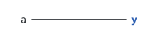

# 2.1 wire

**New concept:** `<=` is the concurrent assignment; there is no `assign`.

A concurrent signal assignment in the architecture body is a permanent connection.
Whenever the right-hand side changes, the left-hand side updates.

```vhdl
led_green <= sensor_ok;
```

Output ports can be assigned but (before VHDL-2008) not read. In VHDL-2008 you
may read an `out` port inside the architecture, which GHDL with `--std=08` allows.

**Coming from Verilog:** `assign y = a;` becomes `y <= a;`. There is no `assign` keyword. In VHDL `=` is only ever a comparison; variables (Section 5) are assigned with `:=`.

## Task

Connect input `a` straight to output `y`.



## Ports

```vhdl
entity top_module is
  port (
    a : in  std_logic;
    y : out std_logic
  );
end entity top_module;
```

## Hints

<details><summary>Hint 1</summary>

`y <= a;`

</details>

## Check

```
./check.py 2.1
```
