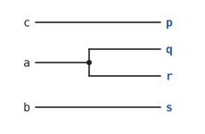

# 2.2 fanout

**New concept:** several concurrent statements; their order doesn't matter.

The statements in an architecture body are not executed top to bottom. Each one is
its own little process that wakes up when its inputs change. Reordering them
changes nothing.

```vhdl
z <= x;     -- these two lines describe the same circuit
w <= z;     -- in either order
```

**Coming from Verilog:** Same as several `assign`s: order is irrelevant.

## Task

`p` follows `c`, `q` and `r` both follow `a`, and `s` follows `b`.



## Ports

```vhdl
entity top_module is
  port (
    a, b, c    : in  std_logic;
    p, q, r, s : out std_logic
  );
end entity top_module;
```

## Hints

<details><summary>Hint 1</summary>

Four one-line assignments. Try writing them in a scrambled order to convince yourself it doesn't matter.

</details>

## Check

```
./check.py 2.2
```
