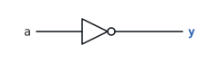

# 2.3 notgate

**New concept:** `not` is a keyword operator.

VHDL's logical operators are keywords: `not`, `and`, `or`, `nand`, `nor`, `xor`,
`xnor`. They work on `std_logic` and, element by element, on vectors of the same length.

```vhdl
led_n <= not led;
```

**Coming from Verilog:** `~a` and `!a` are both `not a`.

## Task

Output the inverse of `a` on `y`.



## Ports

```vhdl
entity top_module is
  port (
    a : in  std_logic;
    y : out std_logic
  );
end entity top_module;
```

## Hints

<details><summary>Hint 1</summary>

`not` binds tighter than the binary operators, so `not a` needs no parentheses here.

</details>

## Check

```
./check.py 2.3
```
