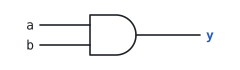

# 2.4 andgate

**New concept:** binary operators on `std_logic`.

```vhdl
both_ready <= rx_ready and tx_ready;
```

`std_logic` has nine values, not two. `and` handles all of them sensibly:
`'0' and 'X'` is `'0'`, while `'1' and 'X'` is `'X'`.

**Coming from Verilog:** `a & b` is `a and b`. In VHDL `&` means concatenation.

## Task

`y` is `a` AND `b`.



## Ports

```vhdl
entity top_module is
  port (
    a, b : in  std_logic;
    y    : out std_logic
  );
end entity top_module;
```

## Hints

<details><summary>Hint 1</summary>

`y <= a and b;`

</details>

## Check

```
./check.py 2.4
```
