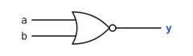

# 2.5 norgate

**New concept:** VHDL has `nor`/`nand`/`xnor` keywords.

Inverted gates are operators of their own:

```vhdl
any_low <= x nand y;    -- same as not (x and y)
```

**Coming from Verilog:** `~(a | b)` can be written directly as `a nor b`.

## Task

`y` is `a` NOR `b`.



## Ports

```vhdl
entity top_module is
  port (
    a, b : in  std_logic;
    y    : out std_logic
  );
end entity top_module;
```

## Hints

<details><summary>Hint 1</summary>

Either `a nor b` or `not (a or b)` works.

</details>

## Check

```
./check.py 2.5
```
