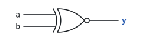

# 2.6 xnorgate

**New concept:** `and`, `or`, and `xor` all have equal precedence, so mixed expressions need parentheses (`a and b or c` is a compile error).

In Verilog `&` binds tighter than `|`. VHDL gives all binary logical operators the
**same** precedence and refuses to guess, so mixing them without parentheses fails
to compile:

```vhdl
-- f <= a and b or c;      -- error
f <= (a and b) or c;       -- ok
```

A chain of the *same* operator (`a or b or c`) is fine. `nand` and `nor` can't be
chained at all, because they aren't associative.

**Coming from Verilog:** `a & b | c` relies on precedence. In VHDL you must write the parentheses.

## Task

`y` is `a` XNOR `b`: `'1'` when the inputs are equal.



## Ports

```vhdl
entity top_module is
  port (
    a, b : in  std_logic;
    y    : out std_logic
  );
end entity top_module;
```

## Hints

<details><summary>Hint 1</summary>

There's an `xnor` keyword. As an exercise, also try `not (a xor b)`.

</details>

## Check

```
./check.py 2.6
```
