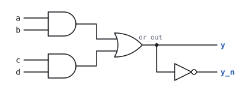

# 2.7 internal_signals

**New concept:** declaring `signal`s between `architecture` and `begin`.

Internal nets are `signal`s. They are declared in the architecture's declarative
region, between `architecture ... is` and `begin`, and then used in the body.

```vhdl
architecture rtl of demo is
  signal mid : std_logic;
begin
  mid <= x xor z;
  out1 <= mid;
  out2 <= not mid;
end architecture rtl;
```

Every signal must have exactly one driver (one assignment statement) unless it is
a resolved bus. More on that in 2.15.

**Coming from Verilog:** A `wire` declaration becomes a `signal` declaration, and it goes in a fixed place: before `begin`.

## Task

`y = (a AND b) OR (c AND d)` and `y_n = NOT y`. Compute the OR result once in an
internal signal and use it for both outputs.



## Ports

```vhdl
entity top_module is
  port (
    a, b, c, d : in  std_logic;
    y, y_n     : out std_logic
  );
end entity top_module;
```

## Hints

<details><summary>Hint 1</summary>

Declare `signal or_out : std_logic;` before `begin`.

</details>

<details><summary>Hint 2</summary>

Remember the parentheses: `(a and b) or (c and d)`.

</details>

## Check

```
./check.py 2.7
```
