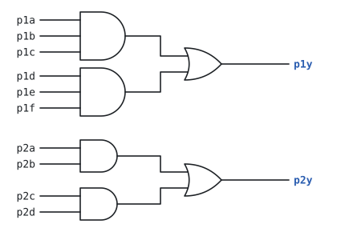

# 2.8 two_gate_chip

**New concept:** describing a small real chip (AND-OR pairs, like a 7458).

Real logic chips are a good exercise in naming. Give each intermediate product term
a signal, then OR them. Several signals of the same type can share one declaration:

```vhdl
signal t1, t2, t3 : std_logic;
```

**Coming from Verilog:** `wire t1, t2;` becomes `signal t1, t2 : std_logic;`.

## Task

Build both halves of the chip:

- `p1y = (p1a·p1b·p1c) + (p1d·p1e·p1f)`
- `p2y = (p2a·p2b) + (p2c·p2d)`

Use internal signals for the four AND terms.



## Ports

```vhdl
entity top_module is
  port (
    p1a, p1b, p1c, p1d, p1e, p1f, p2a, p2b, p2c, p2d : in  std_logic;
    p1y, p2y                                         : out std_logic
  );
end entity top_module;
```

## Hints

<details><summary>Hint 1</summary>

Four AND signals, then two OR assignments. `p1a and p1b and p1c` chains fine without parentheses.

</details>

## Check

```
./check.py 2.8
```
