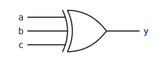

# 2.10 xor3

**New concept:** chaining a single associative operator.

A chain of one operator needs no parentheses: `a or b or c`. Only *mixing*
operators requires them.

```vhdl
any_err <= err0 or err1 or err2;
```

**Coming from Verilog:** Same as `a ^ b ^ c`.

## Task

`y = a XOR b XOR c` (`xor` chains fine without parentheses, unlike mixed operators).



## Ports

```vhdl
entity top_module is
  port (
    a, b, c : in  std_logic;
    y       : out std_logic
  );
end entity top_module;
```

## Hints

<details><summary>Hint 1</summary>

One line.

</details>

## Check

```
./check.py 2.10
```
