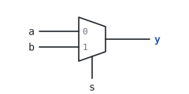

# 2.11 mux2_gates

**New concept:** a mux built only from gates, no `when`.

A 2-to-1 mux is an AND-OR structure: each data input is gated by the select (or its
inverse), and the two products are ORed. Later you'll write muxes with `when` and
`case`, but it helps to see the gates once.

**Coming from Verilog:** No `? :` operator for now; build it from `and`/`or`/`not`.

## Task

`y = b` when `s = '1'`, else `a`. Use only logical operators.



## Ports

```vhdl
entity top_module is
  port (
    a, b, s : in  std_logic;
    y       : out std_logic
  );
end entity top_module;
```

## Hints

<details><summary>Hint 1</summary>

`(b and s)` passes `b` when `s` is high.

</details>

<details><summary>Hint 2</summary>

Don't forget the parentheses around each product term.

</details>

## Check

```
./check.py 2.11
```
