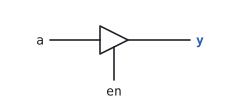

# 2.15 tristate

**New concept:** the nine `std_logic` values; `'Z'` (high-impedance) as a driven value.

`std_logic` is not a two-valued bit. It has nine values:

| value | meaning |
|---|---|
| `'U'` | uninitialized: nothing has ever been assigned (the default start value in simulation) |
| `'X'` | forcing unknown: e.g. two drivers fighting with `'0'` and `'1'` |
| `'0'`, `'1'` | forcing low / high |
| `'Z'` | high impedance: this driver is letting go of the wire |
| `'W'`, `'L'`, `'H'` | weak unknown / low / high (pull resistors) |
| `'-'` | don't care (for synthesis and matching comparisons) |

The **resolution function** decides the value of a signal that has more than one
driver. `'Z'` loses to anything, so a driver that outputs `'Z'` effectively
disconnects. `'0'` against `'1'` gives `'X'`. That's how tri-state buses work:

```vhdl
bus_line <= tx_data when tx_en = '1' else 'Z';
```

`'U'` is useful when debugging: an output that stays `'U'` in the waveform was
never assigned.

Inside FPGAs there are no internal tri-state buffers; synthesis turns internal
`'Z'` logic into muxes. Real `'Z'` only exists at I/O pins.

**Coming from Verilog:** `1'bz` is `'Z'` (uppercase; `'z'` is a different, invalid character literal for `std_logic`). The `? :` form becomes `when ... else`.

## Task

`y = a` when `en = '1'`, otherwise `'Z'`. The grader compares `'Z'` exactly.

Use a conditional assignment, which you'll meet properly in Section 5:
`target <= value1 when condition else value2;`



## Ports

```vhdl
entity top_module is
  port (
    a, en : in  std_logic;
    y     : out std_logic
  );
end entity top_module;
```

## Hints

<details><summary>Hint 1</summary>

`y <= a when en = '1' else 'Z';`

</details>

## Check

```
./check.py 2.15
```
