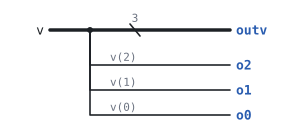

# 3.1 vec_split

**New concept:** `std_logic_vector`, `downto`, single-bit indexing.

A vector is declared with its index range. `downto` puts the highest index on the
left, which is the usual convention for numbers (MSB first).

```vhdl
signal flags : std_logic_vector(3 downto 0);
...
busy <= flags(2);        -- one bit: parentheses, not brackets
```

Assigning a whole vector requires the same length on both sides.

**Coming from Verilog:** `v[2]` becomes `v(2)`, and `[2:0]` in a declaration becomes `(2 downto 0)`.

## Task

Pass the 3-bit vector `v` through to `outv` unchanged, and also break it out into individual bits `o2`, `o1`, `o0`.



## Ports

```vhdl
entity top_module is
  port (
    v          : in  std_logic_vector(2 downto 0);
    outv       : out std_logic_vector(2 downto 0);
    o2, o1, o0 : out std_logic
  );
end entity top_module;
```

## Hints

<details><summary>Hint 1</summary>

`o0 <= v(0);` and so on.

</details>

## Check

```
./check.py 3.1
```
