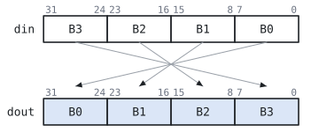

# 3.3 byte_swap

**New concept:** assigning to slices of an output.

A slice can also be the *target* of an assignment, which is handy when building an
output piece by piece:

```vhdl
pkt(15 downto 8) <= header;
pkt(7 downto 0)  <= payload;
```

**Coming from Verilog:** Same as `assign y[15:8] = ...;`, without `assign`.

## Task

Reverse the byte order of the 32-bit word `din` (endianness swap): byte 0 goes to byte 3, byte 1 to byte 2, and so on.



## Ports

```vhdl
entity top_module is
  port (
    din  : in  std_logic_vector(31 downto 0);
    dout : out std_logic_vector(31 downto 0)
  );
end entity top_module;
```

## Hints

<details><summary>Hint 1</summary>

Four slice assignments, one per byte of `dout`.

</details>

<details><summary>Hint 2</summary>

Alternatively, one concatenation: `din(7 downto 0) & din(15 downto 8) & ...`.

</details>

## Check

```
./check.py 3.3
```
