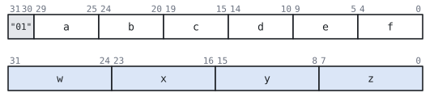

# 3.6 concat

**New concept:** `&` concatenation to build a value, then slices to break it apart.

`&` joins vectors and bits into a longer vector, left operand first (MSB side):

```vhdl
word <= "10" & addr & '0';     -- 2 + 5 + 1 = 8 bits when addr is 5 bits
```

Lengths have to add up exactly to the target width.

**Coming from Verilog:** `{a, b}` becomes `a & b`. There's no replication `{4{x}}` operator; see 3.9.

## Task

Form the 32-bit value `"01" & a & b & c & d & e & f` (six 5-bit inputs, MSB first),
then split it into four bytes: `w` is the top byte and `z` the bottom.



## Ports

```vhdl
entity top_module is
  port (
    a, b, c, d, e, f : in  std_logic_vector(4 downto 0);
    w, x, y, z       : out std_logic_vector(7 downto 0)
  );
end entity top_module;
```

## Hints

<details><summary>Hint 1</summary>

Declare a 32-bit internal signal for the concatenation.

</details>

<details><summary>Hint 2</summary>

`w <= all32(31 downto 24);` etc.

</details>

## Check

```
./check.py 3.6
```
