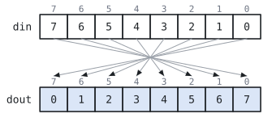

# 3.7 bit_reverse

**New concept:** `for ... generate`, or a loop in a process. VHDL has no built-in reverse operator.

A `for ... generate` replicates concurrent statements. The loop index is a constant
in each copy, so it can be used in index arithmetic:

```vhdl
gen_inv: for i in 0 to 3 generate
  q(i) <= not d(i);
end generate gen_inv;
```

Generate statements need a label (`gen_inv:` above).

**Coming from Verilog:** A Verilog `generate for` with a `genvar` maps directly; VHDL needs no separate genvar declaration.

## Task

Reverse the bit order: `dout(i) = din(7-i)`.



## Ports

```vhdl
entity top_module is
  port (
    din  : in  std_logic_vector(7 downto 0);
    dout : out std_logic_vector(7 downto 0)
  );
end entity top_module;
```

## Hints

<details><summary>Hint 1</summary>

`dout(i) <= din(7 - i);` inside a labelled `for i in 0 to 7 generate`.

</details>

## Check

```
./check.py 3.7
```
