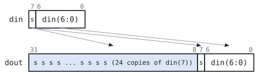

# 3.8 sign_extend

**New concept:** aggregates `(others => x)` and `(23 downto 0 => din(7))`.

An **aggregate** builds a vector by naming element positions:

```vhdl
zeros <= (others => '0');                 -- every bit '0', any width
mask  <= (7 downto 4 => '1', others => '0');
```

The value in an aggregate can be a signal, so `(others => sel)` copies one bit
into every position. Combined with `&`, that's sign extension.

**Coming from Verilog:** `{24{din[7]}}` replication becomes `(23 downto 0 => din(7))`.

## Task

Sign-extend the 8-bit two's-complement value `din` to 32 bits. (Section 6 revisits this with `resize` on `signed`.)



## Ports

```vhdl
entity top_module is
  port (
    din  : in  std_logic_vector(7 downto 0);
    dout : out std_logic_vector(31 downto 0)
  );
end entity top_module;
```

## Hints

<details><summary>Hint 1</summary>

Upper 24 bits are all copies of `din(7)`.

</details>

<details><summary>Hint 2</summary>

Inside a concatenation an `others` aggregate has no known width, so use an explicit range: `(23 downto 0 => din(7)) & din`. Or assign the two slices of `dout` separately.

</details>

## Check

```
./check.py 3.8
```
