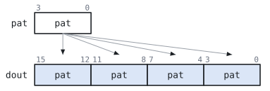

# 3.9 pattern_fill

**New concept:** building a vector by repeated concatenation or a generate loop.

Without a replication operator, short repeats are just written out with `&`, and
longer ones use a generate loop over slices:

```vhdl
g: for i in 0 to 7 generate
  wide(2*i+1 downto 2*i) <= pair;
end generate g;
```

**Coming from Verilog:** `{4{pat}}` has no direct equivalent.

## Task

`dout` is the 4-bit input `pat` repeated four times.



## Ports

```vhdl
entity top_module is
  port (
    pat  : in  std_logic_vector(3 downto 0);
    dout : out std_logic_vector(15 downto 0)
  );
end entity top_module;
```

## Hints

<details><summary>Hint 1</summary>

`pat & pat & pat & pat` works. Try the generate-loop version too.

</details>

## Check

```
./check.py 3.9
```
