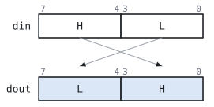

# 3.10 nibble_swap

**New concept:** concatenating two slices of the same vector.

Slices of one signal can be reordered in a single concatenation:

```vhdl
rotated <= v(0) & v(7 downto 1);   -- rotate right by one
```

**Coming from Verilog:** `{din[3:0], din[7:4]}` becomes `din(3 downto 0) & din(7 downto 4)`.

## Task

Swap the two 4-bit halves of the byte `din`.



## Ports

```vhdl
entity top_module is
  port (
    din  : in  std_logic_vector(7 downto 0);
    dout : out std_logic_vector(7 downto 0)
  );
end entity top_module;
```

## Hints

<details><summary>Hint 1</summary>

One concatenation.

</details>

## Check

```
./check.py 3.10
```
