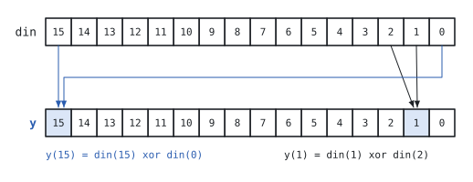

# 3.12 neighbor_xor

**New concept:** index arithmetic with wraparound in a generate loop.

Generate indices are integers, so the usual integer operators work: `+`, `-`, `*`,
`mod`, `rem`. `mod` always returns a result with the sign of the divisor, which
makes it the right choice for wraparound:

```vhdl
g: for i in 0 to 7 generate
  prev_bit(i) <= v((i + 7) mod 8);    -- neighbour to the right, wrapping
end generate g;
```

**Coming from Verilog:** Same idea as a `genvar` loop; `%` is `mod` (or `rem`).

## Task

`y(i) = din(i) XOR din((i+1) mod 16)` for every bit.



## Ports

```vhdl
entity top_module is
  port (
    din : in  std_logic_vector(15 downto 0);
    y   : out std_logic_vector(15 downto 0)
  );
end entity top_module;
```

## Hints

<details><summary>Hint 1</summary>

Bit 15's neighbour is bit 0.

</details>

## Check

```
./check.py 3.12
```
