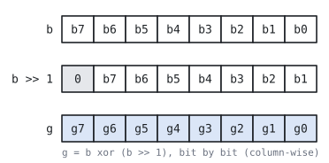

# 3.14 gray_encode

**New concept:** shifting by slicing and concatenating.

Shifting a `std_logic_vector` by a constant is easiest with a slice and a fill bit:

```vhdl
half <= '0' & v(7 downto 1);       -- logical right shift by 1
```

(Section 6 introduces `shift_right` on `unsigned`.)

**Coming from Verilog:** `b >> 1` on a plain vector becomes `'0' & b(7 downto 1)`.

## Task

Convert binary to Gray code: `g = b XOR (b >> 1)`.



## Ports

```vhdl
entity top_module is
  port (
    b : in  std_logic_vector(7 downto 0);
    g : out std_logic_vector(7 downto 0)
  );
end entity top_module;
```

## Hints

<details><summary>Hint 1</summary>

`g <= b xor ('0' & b(7 downto 1));`

</details>

## Check

```
./check.py 3.14
```
