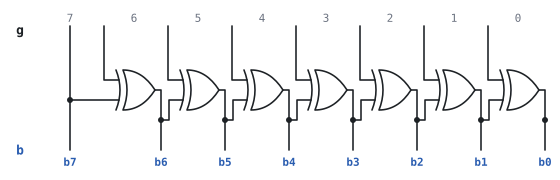

# 3.15 gray_decode

**New concept:** an inherently serial dependency expressed in a loop.

Some outputs depend on the *previous output bit*, not just on inputs. A `for` loop
inside a combinational process with a **variable** handles that: variables update
immediately, so each iteration sees the previous one's result.

```vhdl
process(all)
  variable acc : std_logic;
begin
  acc := '0';
  for i in v'high downto 0 loop
    acc := acc or v(i);
    seen(i) <= acc;          -- '1' from the highest set bit downward
  end loop;
end process;
```

Section 5 covers processes properly; for now, `process(all)` means "re-run whenever
any input changes" and the loop unrolls into a chain of gates.

**Coming from Verilog:** It's like an `always @(*)` with a blocking-assignment loop.

## Task

Convert Gray code back to binary. The MSB passes through unchanged; each lower
binary bit is the XOR of the Gray bit with the binary bit above it:
`b(i) = b(i+1) XOR g(i)`.



## Ports

```vhdl
entity top_module is
  port (
    g : in  std_logic_vector(7 downto 0);
    b : out std_logic_vector(7 downto 0)
  );
end entity top_module;
```

## Hints

<details><summary>Hint 1</summary>

Iterate from bit 7 down to 0, carrying the running XOR in a variable.

</details>

<details><summary>Hint 2</summary>

Equivalently, `b(i)` is the XOR of `g(7 downto i)`, so a generate with `xor g(7 downto i)` works too.

</details>

## Check

```
./check.py 3.15
```
