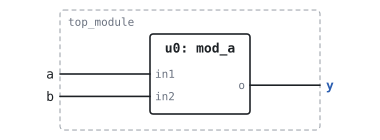

# 4.1 instantiate

**New concept:** direct entity instantiation `u0: entity work.mod_a port map (...)` with named association `=>`.

Every problem in this section ships one or more modules in `provided/`. The grader
compiles them into the same library as your design, so you can use them without
editing them.

A **direct entity instantiation** names the library (`work` is your own design
library), the entity, and how each of its ports connects:

```vhdl
u_inv: entity work.inverter
  port map (
    din  => sensor,       -- formal (the sub-module's port) => actual (your signal)
    dout => sensor_n
  );
```

Every instance needs a label (`u_inv` above). The arrow points from the
sub-module's port name to the signal it connects to, regardless of direction.

**Coming from Verilog:** `mod_a u0 (.in1(a), .in2(b), .o(y));` becomes `u0: entity work.mod_a port map (in1 => a, in2 => b, o => y);`.

## Task

The provided `mod_a(in1, in2: in sl; o: out sl)` computes `o = in1 AND NOT in2`.
Instantiate it with `a → in1`, `b → in2`, and `o → y`.



## Ports

```vhdl
entity top_module is
  port (
    a, b : in  std_logic;
    y    : out std_logic
  );
end entity top_module;
```

## Hints

<details><summary>Hint 1</summary>

Inside the architecture body: `u0: entity work.mod_a port map (in1 => a, in2 => b, o => y);`

</details>

## Check

```
./check.py 4.1
```
