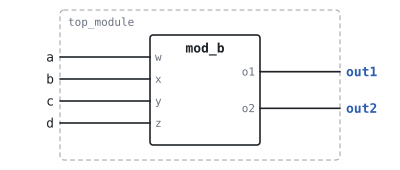

# 4.2 positional_map

**New concept:** positional association, and why named association is safer.

A port map can also list the actuals in the order the ports were declared:

```vhdl
u_inv: entity work.inverter port map (sensor, sensor_n);
```

It's shorter, but if someone reorders the sub-module's ports, your design still
compiles and is silently wrong. Use named association in real code; this problem
is here so you can read the positional style when you meet it.

**Coming from Verilog:** Same trade-off as Verilog's ordered vs. `.name()` port connections.

## Task

The provided `mod_b(w, x, y, z: in sl; o1, o2: out sl)` computes `o1 = w XOR x` and
`o2 = y AND z`. Connect `a, b, c, d` to `w, x, y, z` **by position**, and `o1`/`o2`
to `out1`/`out2`.



## Ports

```vhdl
entity top_module is
  port (
    a, b, c, d : in  std_logic;
    out1, out2 : out std_logic
  );
end entity top_module;
```

## Hints

<details><summary>Hint 1</summary>

`u0: entity work.mod_b port map (a, b, c, d, out1, out2);`

</details>

## Check

```
./check.py 4.2
```
