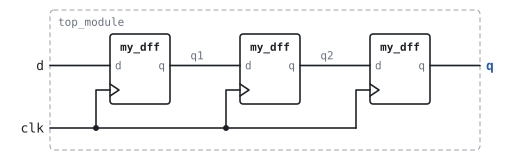

# 4.3 three_dffs

**New concept:** instantiating several copies with internal signals between them.

Connect instances to each other through internal signals. Each instance needs its
own label:

```vhdl
signal s1 : std_logic;
...
u_a: entity work.buf port map (i => x,  o => s1);
u_b: entity work.buf port map (i => s1, o => z);
```

Since the provided flip-flops have no reset, their outputs start as `'U'` in
simulation. The grader treats `'U'` on both sides as a match, so that's fine here.

**Coming from Verilog:** Same as wiring Verilog instances with `wire`s, but the nets are `signal`s declared before `begin`.

## Task

Using the provided `my_dff(clk, d: in sl; q: out sl)`, chain three flip-flops into a
3-stage shift register: `d → q1 → q2 → q`.



## Ports

```vhdl
entity top_module is
  port (
    clk, d : in  std_logic;
    q      : out std_logic
  );
end entity top_module;
```

## Hints

<details><summary>Hint 1</summary>

Two internal signals and three instances, all sharing `clk`.

</details>

## Check

```
./check.py 4.3
```
