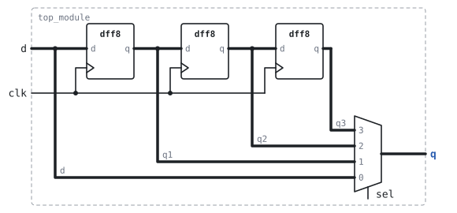

# 4.4 tap_select

**New concept:** instances plus a `case`/`with-select` mux.

A **selected signal assignment** is a concurrent mux:

```vhdl
with mode select
  led <= "0001" when "00",
         "0010" when "01",
         "0100" when "10",
         "1000" when others;
```

The choices must cover every possible value of the selector, which for a
`std_logic_vector` includes the nine-valued combinations, hence `when others`.
Section 5 covers this in detail.

**Coming from Verilog:** A `case` inside `always @(*)` or a chain of `? :`. Here a concurrent `with ... select` does the job without a process.

## Task

The provided `my_dff8(clk: in sl; d: in slv(7:0); q: out slv(7:0))` is an 8-bit
register. Chain three of them. The 2-bit `sel` chooses the output: 0 gives `d`
itself (no delay), 1 gives the first stage, 2 the second, and 3 the third.



## Ports

```vhdl
entity top_module is
  port (
    clk : in  std_logic;
    d   : in  std_logic_vector(7 downto 0);
    sel : in  std_logic_vector(1 downto 0);
    q   : out std_logic_vector(7 downto 0)
  );
end entity top_module;
```

## Hints

<details><summary>Hint 1</summary>

Three 8-bit internal signals for the stage outputs, then `with sel select q <= ...`.

</details>

## Check

```
./check.py 4.4
```
