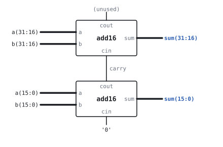

# 4.5 adder32

**New concept:** wiring a carry between instances.

Large adders are often built from smaller ones by passing the carry along. A port
can connect to a slice of a signal, or to a literal for an input:

```vhdl
u_lo: entity work.add8 port map (a => x(7 downto 0), b => z(7 downto 0),
                                 cin => '0', sum => s(7 downto 0), cout => c8);
```

An unused output can be left unconnected with `open`: `cout => open`.

**Coming from Verilog:** Unconnected outputs are `.cout()` in Verilog and `cout => open` in VHDL.

## Task

The provided `add16(a, b: in slv(15:0); cin: in sl; sum: out slv(15:0); cout: out sl)`
is a 16-bit adder. Build a 32-bit adder from two of them. Tie the first `cin` to
`'0'` and discard the final carry.



## Ports

```vhdl
entity top_module is
  port (
    a, b : in  std_logic_vector(31 downto 0);
    sum  : out std_logic_vector(31 downto 0)
  );
end entity top_module;
```

## Hints

<details><summary>Hint 1</summary>

One internal carry signal links the lower `cout` to the upper `cin`.

</details>

## Check

```
./check.py 4.5
```
