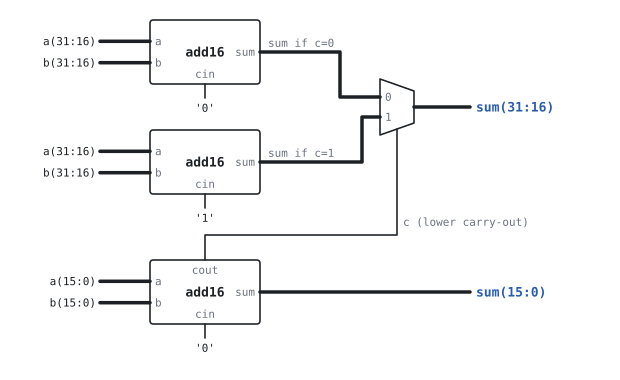

# 4.6 carry_select

**New concept:** duplicating hardware to save delay.

In a ripple design the upper half has to wait for the lower half's carry. A
**carry-select** adder computes the upper half twice in parallel, once assuming
carry 0 and once assuming carry 1, and uses the real carry only to pick a result.
That trades area for speed: the critical path is one 16-bit add plus a mux.

A conditional assignment works as a vector mux:

```vhdl
result <= alt when use_alt = '1' else normal;
```

**Coming from Verilog:** The final mux is `assign sum_hi = c16 ? s1 : s0;`, written with `when ... else`.

## Task

Using three provided `add16`s, build a carry-select adder. The lower half adds
normally (carry-in 0). Both possible upper halves (carry-in 0 and 1) are computed in
parallel, and the lower half's carry-out picks between them.



## Ports

```vhdl
entity top_module is
  port (
    a, b : in  std_logic_vector(31 downto 0);
    sum  : out std_logic_vector(31 downto 0)
  );
end entity top_module;
```

## Hints

<details><summary>Hint 1</summary>

Signals: the lower carry-out, and two 16-bit candidate upper sums.

</details>

## Check

```
./check.py 4.6
```
