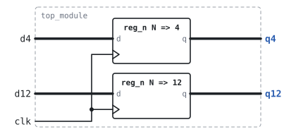

# 4.7 generic_map

**New concept:** `generic map`. Generics are VHDL's parameters.

A **generic** is a constant parameter of an entity, set per instance. Generics go in
a `generic map` before the `port map`:

```vhdl
u_fifo: entity work.fifo
  generic map (DEPTH => 16)
  port map (...);
```

Port widths can depend on generics, so the actual you connect must match the width
the generic implies.

**Coming from Verilog:** `#(.N(4))` becomes `generic map (N => 4)`.

## Task

The provided `reg_n` has `generic (N: positive)` and ports
`(clk: in sl; d: in slv(N-1:0); q: out slv(N-1:0))`. Instantiate a 4-bit copy for
`d4 → q4` and a 12-bit copy for `d12 → q12`.



## Ports

```vhdl
entity top_module is
  port (
    clk : in  std_logic;
    d4  : in  std_logic_vector(3 downto 0);
    q4  : out std_logic_vector(3 downto 0);
    d12 : in  std_logic_vector(11 downto 0);
    q12 : out std_logic_vector(11 downto 0)
  );
end entity top_module;
```

## Hints

<details><summary>Hint 1</summary>

Two instances of `entity work.reg_n`, each with its own `generic map (N => ...)`.

</details>

## Check

```
./check.py 4.7
```
