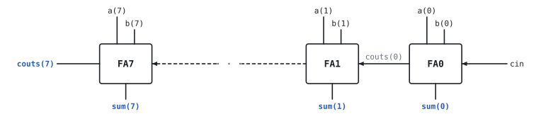

# 4.8 generate_adder

**New concept:** `for ... generate` with instances and a carry array signal.

A `for ... generate` can create instances too. Carries between stages are easiest
to handle as a vector one bit longer than the adder, so that stage `i` reads
`c(i)` and writes `c(i+1)`:

```vhdl
signal c : std_logic_vector(4 downto 0);
...
c(0) <= carry_in;
g: for i in 0 to 3 generate
  u: entity work.cell port map (x => p(i), ci => c(i), co => c(i + 1), ...);
end generate g;
```

**Coming from Verilog:** Same as a `genvar` loop containing an instance.

## Task

Using the provided `full_adder(a, b, cin: in sl; s, cout: out sl)`, generate an
8-bit ripple-carry adder. Output every stage's carry-out on `couts`, where
`couts(7)` is the final carry.



## Ports

```vhdl
entity top_module is
  port (
    a, b  : in  std_logic_vector(7 downto 0);
    cin   : in  std_logic;
    sum   : out std_logic_vector(7 downto 0);
    couts : out std_logic_vector(7 downto 0)
  );
end entity top_module;
```

## Hints

<details><summary>Hint 1</summary>

Stage 0 takes `cin`; stage `i > 0` takes `couts(i-1)`.

</details>

<details><summary>Hint 2</summary>

A 9-bit internal carry vector avoids the special case for stage 0.

</details>

## Check

```
./check.py 4.8
```
