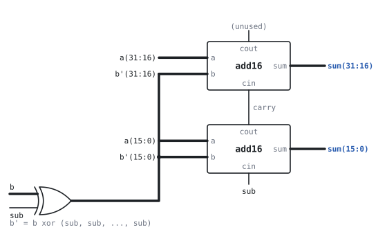

# 4.9 add_sub

**New concept:** reusing an adder for subtraction (XOR the B input, carry-in = sub).

In two's complement, `a - b = a + (not b) + 1`. So one adder does both: XOR `b`
with the `sub` control (which inverts it when `sub = '1'`) and feed `sub` in as the
carry-in.

To XOR every bit of a vector with one bit, build a vector of copies:

```vhdl
flipped <= v xor (v'range => inv);
```

**Coming from Verilog:** `b ^ {32{sub}}` becomes `b xor (31 downto 0 => sub)`.

## Task

Using two provided `add16`s and your own XOR logic, `result = a + b` when
`sub = '0'` and `a - b` when `sub = '1'` (32-bit, wrapping).



## Ports

```vhdl
entity top_module is
  port (
    a, b   : in  std_logic_vector(31 downto 0);
    sub    : in  std_logic;
    result : out std_logic_vector(31 downto 0)
  );
end entity top_module;
```

## Hints

<details><summary>Hint 1</summary>

The lower adder's `cin` is `sub`, and its carry-out feeds the upper adder.

</details>

## Check

```
./check.py 4.9
```
