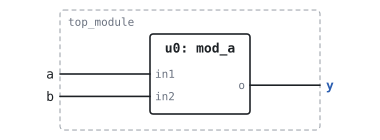

# 4.10 component_decl

**New concept:** the older `component` declaration style, which is still common in legacy and vendor code.

Before direct entity instantiation (VHDL-93), every sub-module had to be declared as
a `component` in the architecture, repeating its port list. The instance then names
the component, without `entity work.`:

```vhdl
architecture rtl of top is
  component inverter is
    port (din : in std_logic; dout : out std_logic);
  end component;
begin
  u_inv: inverter port map (din => s, dout => s_n);
end architecture rtl;
```

You'll see this in vendor IP wrappers (where the entity may be a black box at
compile time) and older code bases. The binding to the entity happens at
elaboration by matching names.

**Coming from Verilog:** Verilog never needed this; it's closest to an `extern` declaration.

## Task

Same circuit as 4.1, but declare `mod_a` as a `component` in the architecture and instantiate it without `entity work.`.



## Ports

```vhdl
entity top_module is
  port (
    a, b : in  std_logic;
    y    : out std_logic
  );
end entity top_module;
```

## Hints

<details><summary>Hint 1</summary>

Copy `mod_a`'s port list into a `component mod_a is ... end component;` before `begin`.

</details>

## Check

```
./check.py 4.10
```
