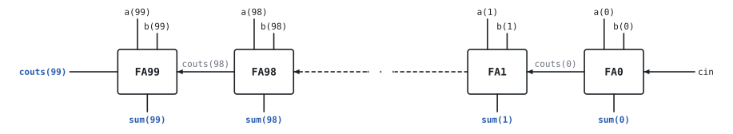

# 4.11 adder100_generate

**New concept:** scaling a generate loop up.

Generate loops don't care about size. Use the vectors' attributes to avoid magic
numbers: `a'range` is `99 downto 0`, `a'high` is 99, `a'length` is 100.

```vhdl
g: for i in din'range generate ... end generate g;
```

**Coming from Verilog:** Same as a 100-iteration `genvar` loop.

## Task

Using the provided `full_adder`, generate a 100-bit ripple-carry adder and output
every carry on `couts` (`couts(99)` is the final carry).



## Ports

```vhdl
entity top_module is
  port (
    a, b  : in  std_logic_vector(99 downto 0);
    cin   : in  std_logic;
    sum   : out std_logic_vector(99 downto 0);
    couts : out std_logic_vector(99 downto 0)
  );
end entity top_module;
```

## Hints

<details><summary>Hint 1</summary>

Exactly 4.8 with bigger numbers.

</details>

## Check

```
./check.py 4.11
```
