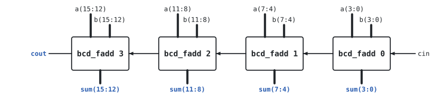

# 4.12 bcd_ripple4

**New concept:** generating a chain of a provided multi-bit cell.

BCD (binary-coded decimal) stores one decimal digit per 4-bit nibble, so
`x"1234"` represents decimal 1234. A BCD adder adds digit by digit, passing a
decimal carry from each digit to the next.

Slices with computed bounds work in generate loops:
`v(4*i + 3 downto 4*i)` is nibble `i`.

**Coming from Verilog:** Same as part-selects `v[4*i +: 4]` in a generate loop.

## Task

The provided `bcd_fadd(a, b: in slv(3:0); cin: in sl; s: out slv(3:0); cout: out sl)`
adds one BCD digit. Generate a 4-digit (16-bit) BCD adder. Inputs are always
valid BCD.



## Ports

```vhdl
entity top_module is
  port (
    a, b : in  std_logic_vector(15 downto 0);
    cin  : in  std_logic;
    sum  : out std_logic_vector(15 downto 0);
    cout : out std_logic
  );
end entity top_module;
```

The grader only generates valid BCD inputs (each nibble 0–9).

## Hints

<details><summary>Hint 1</summary>

A 5-bit carry vector, nibble slices `4*i+3 downto 4*i`, and `cout` is the last carry.

</details>

## Check

```
./check.py 4.12
```
