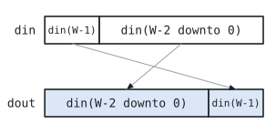

# 4.13 own_generic

**New concept:** writing (not just using) a generic entity.

Your own entity can have generics. Inside the architecture, generics are constants,
and port ranges can use them:

```vhdl
entity pad is
  generic (W : positive := 8);
  port (din : in std_logic_vector(W - 1 downto 0); ...);
```

Write the body without assuming any particular `W`: use `W` itself or attributes
like `din'high`.

**Coming from Verilog:** `parameter W = 6` becomes `generic (W : positive := 6)`.

## Task

The stub has `generic (W: positive := 6)`. Output `din` rotated left by one, for
any `W`: the MSB wraps around to bit 0.

The grader uses the default `W = 6`. Then try a different width:

```
./check.py 4.13 -g W=10
```



## Ports

```vhdl
entity top_module is
  generic (
    W : positive := 6
  );
  port (
    din  : in  std_logic_vector(W-1 downto 0);
    dout : out std_logic_vector(W-1 downto 0)
  );
end entity top_module;
```

## Hints

<details><summary>Hint 1</summary>

`din(W - 2 downto 0) & din(W - 1)`

</details>

## Check

```
./check.py 4.13
```
