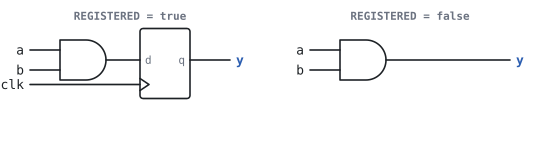

# 4.14 if_generate

**New concept:** `if ... generate` controlled by a boolean generic.

`if ... generate` includes or excludes concurrent statements at elaboration time,
based on a constant condition (usually a generic). VHDL-2008 allows `elsif` and
`else` branches:

```vhdl
g_dbg: if DEBUG generate
  led <= state_bits;
else generate
  led <= (others => '0');
end generate g_dbg;
```

**Coming from Verilog:** Same as a Verilog `generate if`.

## Task

`generic (REGISTERED: boolean := true)`. When true, `y` is `a AND b` registered on
the rising edge of `clk`; when false, it's `a AND b` combinationally. The grader
checks the default, and `./check.py 4.14 -g REGISTERED=false` checks the other
branch.



## Ports

```vhdl
entity top_module is
  generic (
    REGISTERED : boolean := true
  );
  port (
    clk, a, b : in  std_logic;
    y         : out std_logic
  );
end entity top_module;
```

## Hints

<details><summary>Hint 1</summary>

Two branches: one with a `process(clk)` and `if rising_edge(clk)`, one with a plain `y <= a and b;`.

</details>

## Check

```
./check.py 4.14
```
