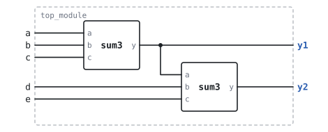

# 4.15 two_level_hier

**New concept:** hierarchy deeper than one level; the learner writes a submodule entity in the same file.

A file can hold several design units. Each entity needs its own `library`/`use`
context clause, because a context clause only applies to the next design unit.
The sub-module has to come before the entity that instantiates it, since GHDL
analyzes the file top to bottom.

```vhdl
library ieee;
use ieee.std_logic_1164.all;
entity helper is ... end entity;
architecture rtl of helper is ... end architecture;

library ieee;
use ieee.std_logic_1164.all;
entity top_module is ...
```

**Coming from Verilog:** In Verilog, `module`s can appear in any order. VHDL needs the sub-module analyzed first.

## Task

Write your own `entity sum3` (inputs `a, b, c`, output `y = a XOR b XOR c`) **in the
same file**, above `top_module`. Instantiate it twice so that
`y1 = sum3(a, b, c)` and `y2 = sum3(y1, d, e)`.



## Ports

```vhdl
entity top_module is
  port (
    a, b, c, d, e : in  std_logic;
    y1, y2        : out std_logic
  );
end entity top_module;
```

## Hints

<details><summary>Hint 1</summary>

`sum3` has ports like `a, b, c : in std_logic; y : out std_logic`.

</details>

<details><summary>Hint 2</summary>

In VHDL-2008 you can connect the second instance directly to output port `y1`, since `out` ports are readable.

</details>

## Check

```
./check.py 4.15
```
