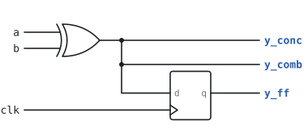

# 5.2 clocked_process

**New concept:** `process(clk)` + `if rising_edge(clk) then`.

A flip-flop is a process that only acts on a clock edge:

```vhdl
process(clk)
begin
  if rising_edge(clk) then
    q <= d;
  end if;
end process;
```

`rising_edge(clk)` is true only during the simulation cycle in which `clk` goes
from `'0'` to `'1'`. Every signal assigned inside that `if` becomes a register.

**Coming from Verilog:** `always @(posedge clk) q <= d;` becomes the process above.

## Task

Compute `a XOR b` three ways: concurrently (`y_conc`), in a combinational
`process(all)` (`y_comb`), and registered in a clocked process (`y_ff`).

`y_conc` and `y_comb` are identical; `y_ff` lags by one clock.



## Ports

```vhdl
entity top_module is
  port (
    clk, a, b            : in  std_logic;
    y_conc, y_comb, y_ff : out std_logic
  );
end entity top_module;
```

## Hints

<details><summary>Hint 1</summary>

Three statements: one concurrent assignment and two processes.

</details>

## Check

```
./check.py 5.2
```
