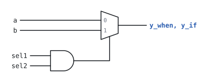

# 5.3 if_mux

**New concept:** `when ... else` (concurrent) vs. `if/elsif/else` (in a process).

The same choice can be written two ways. Outside a process, a **conditional
signal assignment**:

```vhdl
led <= '1' when error = '1' else blink;
```

Inside a process, an `if` statement:

```vhdl
process(all)
begin
  if error = '1' then
    led <= '1';
  else
    led <= blink;
  end if;
end process;
```

Conditions must be `boolean`: write `error = '1'`, not just `error`.
(VHDL-2008 does allow `if error then` for `std_logic` via the `??` condition
operator, but the explicit form is clearer.)

**Coming from Verilog:** `assign y = c ? b : a;` becomes `y <= b when c = '1' else a;`.

## Task

Select `b` when both `sel1` and `sel2` are `'1'`, otherwise select `a`. Produce the
same result twice: `y_when` with a conditional assignment and `y_if` with an `if`
in a process.



## Ports

```vhdl
entity top_module is
  port (
    a, b, sel1, sel2 : in  std_logic;
    y_when, y_if     : out std_logic
  );
end entity top_module;
```

## Hints

<details><summary>Hint 1</summary>

The condition is `sel1 = '1' and sel2 = '1'`, a boolean expression.

</details>

## Check

```
./check.py 5.3
```
