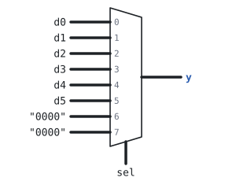

# 5.4 case_mux

**New concept:** `case` statements need `when others`, because a `std_logic_vector` has 9^n possible values.

A `case` statement inside a process picks one branch by value:

```vhdl
case code is
  when "00"   => color <= RED_RGB;
  when "01"   => color <= GREEN_RGB;
  when others => color <= BLACK_RGB;
end case;
```

The choices must cover **every** possible value of the selector. A 2-bit
`std_logic_vector` has 81 values (`"UX"`, `"Z1"`, ...), so `when others` is
effectively mandatory. Several values can share a branch with `|`:
`when "10" | "11" =>`.

**Coming from Verilog:** Verilog's `default:` is `when others =>`, and it's required here, not optional.

## Task

Build a 6-to-1 mux of 4-bit inputs selected by `sel` (0 → `d0` … 5 → `d5`). If
`sel` is 6 or 7, output `"0000"`.



## Ports

```vhdl
entity top_module is
  port (
    sel                    : in  std_logic_vector(2 downto 0);
    d0, d1, d2, d3, d4, d5 : in  std_logic_vector(3 downto 0);
    y                      : out std_logic_vector(3 downto 0)
  );
end entity top_module;
```

## Hints

<details><summary>Hint 1</summary>

Six explicit choices `"000"` … `"101"` and one `when others => y <= "0000";`.

</details>

## Check

```
./check.py 5.4
```
