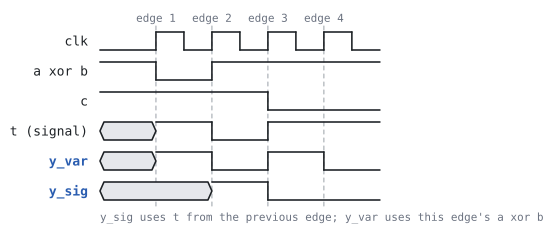

# 5.7 variables_vs_signals

**New concept:** inside a clocked process, a `variable` updates immediately (like blocking `=`) while a `signal` updates at the end of the process (like nonblocking `<=`).

A **variable** is declared inside a process and assigned with `:=`. The new value
is visible on the very next line. A **signal** assignment `<=` only schedules
the new value; the process keeps seeing the old value until it suspends.

```vhdl
process(clk)
  variable v : unsigned(3 downto 0);
begin
  if rising_edge(clk) then
    v := cnt + 1;      -- v has the new value right now
    cnt <= v;          -- cnt changes after this process suspends
    big <= v(3);       -- uses this cycle's v
  end if;
end process;
```

A signal assigned inside a clocked process is a register. Reading it back in the
same process gives last cycle's value, which adds one cycle of delay.

**Coming from Verilog:** A variable behaves like a blocking `=`, and a signal like a nonblocking `<=`. Unlike Verilog, the two can't be mixed up, because they are different kinds of object.

## Task

One clocked process. On every rising edge:

- `y_var` registers `(a XOR b) AND c`, with `a XOR b` held in an intermediate
  **variable** (so it's this cycle's value).
- `y_sig` does the same calculation through an intermediate **signal** assigned in
  the same clocked process. It therefore uses the *previous* cycle's `a XOR b`.

```
clk edge    :   1     2     3     4
a xor b     :   1     0     1     1
c           :   1     1     1     0
t (signal)  :   ?  →  1  →  0  →  1  →  1   (t takes a xor b at each edge)
y_var after :   1     0     1     0         ((a xor b) and c, same edge)
y_sig after :   ?     1     0     0         (old t and c)
```

`y_sig` is what you get when you meant `y_var`. That's one of the most common VHDL
bugs (see 16.3).



## Ports

```vhdl
entity top_module is
  port (
    clk, a, b, c : in  std_logic;
    y_var, y_sig : out std_logic
  );
end entity top_module;
```

## Hints

<details><summary>Hint 1</summary>

Declare `variable v : std_logic;` between `process(clk)` and `begin`, and `signal t : std_logic;` in the architecture.

</details>

<details><summary>Hint 2</summary>

Inside `if rising_edge(clk)`: `v := a xor b; t <= a xor b; y_var <= v and c; y_sig <= t and c;`

</details>

## Check

```
./check.py 5.7
```
