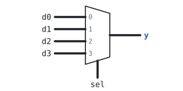

# 5.8 with_select

**New concept:** concurrent selected assignment `with sel select y <= ...`.

`with ... select` is the concurrent cousin of `case`. It is a single statement,
so it can live directly in the architecture body:

```vhdl
with op select
  res <= x and z when "00",
         x or z  when "01",
         x xor z when others;
```

The same coverage rule applies: `when others` is needed for `std_logic_vector`
selectors.

**Coming from Verilog:** A `case` in an `always @(*)`, written without the process.

## Task

Build a 4-to-1 mux of 8-bit inputs `d0..d3` selected by `sel`, without a process.



## Ports

```vhdl
entity top_module is
  port (
    sel            : in  std_logic_vector(1 downto 0);
    d0, d1, d2, d3 : in  std_logic_vector(7 downto 0);
    y              : out std_logic_vector(7 downto 0)
  );
end entity top_module;
```

## Hints

<details><summary>Hint 1</summary>

Four choices, the last as `when others`.

</details>

## Check

```
./check.py 5.8
```
