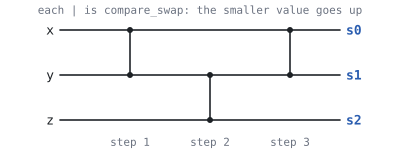

# 5.14 procedure_swap

**New concept:** a `procedure` with `out`/`inout` parameters inside a process.

A **procedure** is a subprogram that returns results through `out` or `inout`
parameters instead of a return value. Declared inside a process, it can work on
the process's variables:

```vhdl
process(all)
  procedure clip(variable v : inout unsigned(7 downto 0)) is
  begin
    if v > 200 then v := to_unsigned(200, 8); end if;
  end procedure;
  variable t : unsigned(7 downto 0);
begin
  t := unsigned(level);
  clip(t);
  out_level <= std_logic_vector(t);
end process;
```

**Coming from Verilog:** Closest to a Verilog `task` with output arguments.

## Task

Write a procedure `compare_swap(lo, hi)` that takes two `inout` 8-bit unsigned
variables and swaps them if `lo > hi`. Use it three times to sort `x`, `y`, `z` so
that `s0 ≤ s1 ≤ s2` (unsigned).



## Ports

```vhdl
entity top_module is
  port (
    x, y, z    : in  std_logic_vector(7 downto 0);
    s0, s1, s2 : out std_logic_vector(7 downto 0)
  );
end entity top_module;
```

## Hints

<details><summary>Hint 1</summary>

A three-element sorting network: compare-swap (0,1), then (1,2), then (0,1) again.

</details>

## Check

```
./check.py 5.14
```
