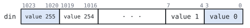

# 6.6 mux256x4

**New concept:** computed slice ranges, `din(4*i+3 downto 4*i)`.

Slice bounds can be expressions. With an integer index, a fixed-width field is
`v(W*i + W - 1 downto W*i)`:

```vhdl
byte_out <= mem_word(8 * k + 7 downto 8 * k);    -- k is an integer
```

The *width* of the slice must be constant (here 8), even though its position
varies. A process with an `integer` variable keeps it readable.

**Coming from Verilog:** `din[sel*4 +: 4]` becomes `din(4*i + 3 downto 4*i)` with `i := to_integer(unsigned(sel))`.

## Task

`din` packs 256 4-bit values: value `i` is `din(4*i+3 downto 4*i)`. Output on `y` the one selected by `sel`.



## Ports

```vhdl
entity top_module is
  port (
    din : in  std_logic_vector(1023 downto 0);
    sel : in  std_logic_vector(7 downto 0);
    y   : out std_logic_vector(3 downto 0)
  );
end entity top_module;
```

## Hints

<details><summary>Hint 1</summary>

In a `process(all)`: `variable i : natural range 0 to 255;` then `i := to_integer(unsigned(sel));`.

</details>

## Check

```
./check.py 6.6
```
