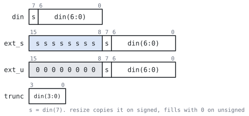

# 6.7 resize_signed

**New concept:** `resize` on `signed` does sign extension, on `unsigned` it zero-extends, and narrowing truncates.

`resize(x, n)` picks its behavior from the type of `x`:

| call | effect when widening |
|---|---|
| `resize(unsigned(v), n)` | pad with zeros |
| `resize(signed(v), n)`   | copy the sign bit |

When narrowing, `resize` on `unsigned` keeps the low bits. On `signed` it keeps the
sign bit **and** the low bits, which is rarely what you want. To truncate, take a
slice instead.

**Coming from Verilog:** `{{8{x[7]}}, x}` becomes `resize(signed(x), 16)`.

## Task

- `ext_s`: `din` sign-extended from 8 to 16 bits
- `ext_u`: `din` zero-extended from 8 to 16 bits
- `trunc`: the low 4 bits of `din`



## Ports

```vhdl
entity top_module is
  port (
    din          : in  std_logic_vector(7 downto 0);
    ext_s, ext_u : out std_logic_vector(15 downto 0);
    trunc        : out std_logic_vector(3 downto 0)
  );
end entity top_module;
```

## Hints

<details><summary>Hint 1</summary>

`ext_s <= std_logic_vector(resize(signed(din), 16));`

</details>

## Check

```
./check.py 6.7
```
