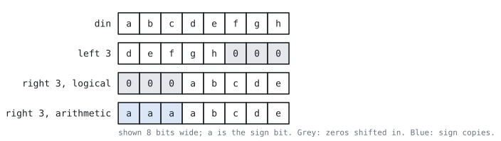

# 6.13 barrel_shifter

**New concept:** `shift_left`/`shift_right` with a `to_integer` amount.

`numeric_std` provides `shift_left(x, n)` and `shift_right(x, n)`. `shift_right`
on `unsigned` fills with zeros; on `signed` it copies the sign bit (an arithmetic
shift).

```vhdl
scaled <= std_logic_vector(shift_right(signed(sample), 3));    -- divide by 8, rounding down
```

The amount is a `natural`, so a vector amount needs `to_integer(unsigned(...))`.

**Coming from Verilog:** `<<`, `>>`, `>>>` become `shift_left`, `shift_right` on `unsigned`, and `shift_right` on `signed`.

## Task

32-bit shifter. `dir = '0'` shifts `din` left (logical), `dir = '1'` shifts right.
When shifting right, `arith = '1'` makes the shift arithmetic (sign-filling) and
`arith = '0'` logical. `arith` doesn't matter for left shifts. The shift amount is
`amt` (0–31).



## Ports

```vhdl
entity top_module is
  port (
    din        : in  std_logic_vector(31 downto 0);
    amt        : in  std_logic_vector(4 downto 0);
    dir, arith : in  std_logic;
    dout       : out std_logic_vector(31 downto 0)
  );
end entity top_module;
```

## Hints

<details><summary>Hint 1</summary>

Three cases: `shift_left(unsigned)`, `shift_right(unsigned)`, `shift_right(signed)`.

</details>

## Check

```
./check.py 6.13
```
