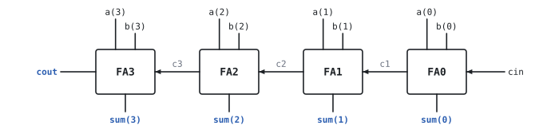

# 7.3 adder4_loop

**New concept:** ripple carry written as a `for` loop with a variable, no instances.

A loop with a carry variable describes a ripple-carry chain without any
sub-modules. Each iteration reads the carry from the previous one:

```vhdl
process(all)
  variable c : std_logic;
begin
  c := '0';
  for i in 0 to 7 loop
    res(i) <= p(i) xor c;
    c := p(i) and c;           -- an incrementer's carry chain
  end loop;
end process;
```

**Coming from Verilog:** Same as a `for` loop with a blocking carry variable.

## Task

4-bit adder: `sum = a + b + cin` with carry-out `cout`. Write it as a loop with a carry variable, not with `numeric_std` `+`.



## Ports

```vhdl
entity top_module is
  port (
    a, b : in  std_logic_vector(3 downto 0);
    cin  : in  std_logic;
    sum  : out std_logic_vector(3 downto 0);
    cout : out std_logic
  );
end entity top_module;
```

## Hints

<details><summary>Hint 1</summary>

The loop body is the 7.2 full adder; `cout` gets the carry variable after the loop.

</details>

## Check

```
./check.py 7.3
```
