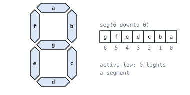

# 7.5 seven_seg

**New concept:** lookup tables via `case` or a constant array.

A lookup table is a `case` with one row per input value, or a constant array
indexed by the input:

```vhdl
type lut_t is array (0 to 3) of std_logic_vector(2 downto 0);
constant LUT : lut_t := ("001", "011", "111", "110");
...
pattern <= LUT(to_integer(unsigned(code)));
```

The seven segments of a display are named `a` to `g`:

```
     aaa
    f   b
    f   b
     ggg
    e   c
    e   c
     ddd
```

Many boards (Nexys, Basys) drive segments **active-low**: `'0'` lights a segment.

**Coming from Verilog:** A `case` in `always @(*)`, or a `localparam` array. VHDL needs an array `type` declaration first.

## Task

Convert the hex digit `hex` (0–F) to a 7-segment pattern, **active-low**, with bit
order `seg(6 downto 0) = g f e d c b a`.

Use the standard hex glyphs: `6` includes the top segment, `7` lights only
`a`, `b`, `c`, `9` includes the bottom segment, and `b` and `d` are lowercase.
`A`, `C`, `E`, `F` are uppercase.



## Ports

```vhdl
entity top_module is
  port (
    hex : in  std_logic_vector(3 downto 0);
    seg : out std_logic_vector(6 downto 0)
  );
end entity top_module;
```

## Hints

<details><summary>Hint 1</summary>

Work out the active-high pattern for each digit first (e.g. `1` lights `b` and `c`: `"0000110"`), then invert.

</details>

<details><summary>Hint 2</summary>

`0` lights every segment except `g`.

</details>

## Check

```
./check.py 7.5
```
