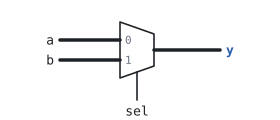

# 7.9 mux2_wide

**New concept:** wide muxes are still one line.

`when ... else` works on vectors of any width, so a 100-bit mux reads exactly like
a 1-bit one.

**Coming from Verilog:** `sel ? b : a` becomes `b when sel = '1' else a`.

## Task

100-bit 2-to-1 mux: `y = b` when `sel = '1'`, else `a`.



## Ports

```vhdl
entity top_module is
  port (
    a, b : in  std_logic_vector(99 downto 0);
    sel  : in  std_logic;
    y    : out std_logic_vector(99 downto 0)
  );
end entity top_module;
```

## Hints

<details><summary>Hint 1</summary>

One line.

</details>

## Check

```
./check.py 7.9
```
