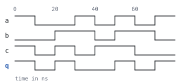

# 7.15 wave_puzzle_comb1

**New concept:** reverse-engineering logic from a waveform.

Sometimes all you have is a simulation trace. Collect the samples into a truth
table (sort them by input), then minimize as usual.

**Coming from Verilog:** Nothing language-specific here.

## Task

Find the combinational circuit that produced this trace:

| time | a | b | c | q |
|---|---|---|---|---|
| 0 ns | 1 | 0 | 1 | 1 |
| 10 ns | 0 | 0 | 0 | 0 |
| 20 ns | 0 | 1 | 1 | 1 |
| 30 ns | 1 | 1 | 0 | 0 |
| 40 ns | 0 | 0 | 1 | 0 |
| 50 ns | 1 | 1 | 1 | 1 |
| 60 ns | 0 | 1 | 0 | 0 |
| 70 ns | 1 | 0 | 0 | 1 |



## Ports

```vhdl
entity top_module is
  port (
    a, b, c : in  std_logic;
    q       : out std_logic
  );
end entity top_module;
```

## Hints

<details><summary>Hint 1</summary>

Sort the rows by `abc`, then draw a 3-input K-map.

</details>

## Check

```
./check.py 7.15
```
