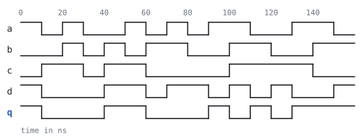

# 7.16 wave_puzzle_comb2

**New concept:** reverse-engineering a 4-input function.

Same idea with four inputs. Look for structure: is `q` sometimes just a copy or the
inverse of one input?

**Coming from Verilog:** Nothing language-specific here.

## Task

Find the combinational circuit that produced this trace:

| time | a | b | c | d | q |
|---|---|---|---|---|---|
| 0 ns | 1 | 0 | 0 | 1 | 1 |
| 10 ns | 0 | 0 | 1 | 0 | 0 |
| 20 ns | 1 | 1 | 1 | 0 | 0 |
| 30 ns | 0 | 0 | 0 | 0 | 0 |
| 40 ns | 0 | 1 | 1 | 1 | 1 |
| 50 ns | 1 | 0 | 1 | 1 | 1 |
| 60 ns | 0 | 1 | 0 | 0 | 0 |
| 70 ns | 1 | 1 | 0 | 1 | 0 |
| 80 ns | 0 | 0 | 0 | 1 | 0 |
| 90 ns | 1 | 0 | 0 | 0 | 1 |
| 100 ns | 1 | 1 | 1 | 1 | 0 |
| 110 ns | 0 | 1 | 1 | 0 | 1 |
| 120 ns | 0 | 0 | 1 | 1 | 0 |
| 130 ns | 1 | 0 | 1 | 0 | 1 |
| 140 ns | 1 | 1 | 0 | 0 | 1 |
| 150 ns | 0 | 1 | 0 | 1 | 1 |



## Ports

```vhdl
entity top_module is
  port (
    a, b, c, d : in  std_logic;
    q          : out std_logic
  );
end entity top_module;
```

## Hints

<details><summary>Hint 1</summary>

Compare the rows with `a = 0` to those with `a = 1`.

</details>

<details><summary>Hint 2</summary>

The answer has a compact form using XOR.

</details>

## Check

```
./check.py 7.16
```
